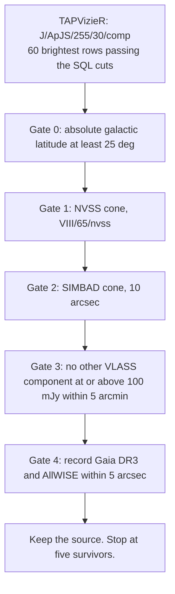

# VLASS–NVSS radio ghosts

Search for compact sources that are bright in the VLASS Epoch 1 Quick Look catalog and missing, or much brighter than their 1.4 GHz flux, in NVSS. The pipeline calls these **radio ghosts**: candidates for emission that appeared or flared on the decadal baseline between NVSS (1.4 GHz, column `S1.4`) and VLASS Epoch 1 (Quick Look components, observed at 3 GHz).

The product is a flux-ordered shortlist of five sources from one declination strip. For every source in that shortlist, the saved NVSS result is the script's placeholder sentence for an empty cone.

The ranked shortlist is [`vlass_ghosts_survivors.json`](vlass_ghosts_survivors.json). `top_survivors.json`, `candidates_vetted.json`, and `raw/` record other components. The [crosswalk](#where-each-name-is-recorded) shows which file contains which name.

## Pipeline

`vlass_ghosts_pipeline.py` uses the Python standard library to query CDS over HTTPS. One ADQL query collects candidates. Each candidate then has to pass four vetoes. A fifth step only records a possible host.



### Candidate query

The script sends this cut to `https://tapvizier.cds.unistra.fr/TAPVizieR/tap/sync`, table `J/ApJS/255/30/comp`, and keeps the first 60 rows ordered by `Ftot` descending:

| Cut | Value in the query |
| --- | --- |
| Total flux | `Ftot >= 20` (the script treats `Ftot` as mJy) |
| Quality flag | `QualFlag = 0` |
| Catalog NVSS distance | `NVSSdist > 30` or `NVSSdist` null |
| Declination | `5 <= DEJ2000 <= 65` degrees |
| Major axis | `Maj <= 6` (stored later as `maj_arcsec`) |

Columns read back: component name, J2000 position, `Ftot`, `e_Ftot`, `Fpeak`, `e_Fpeak`, major and minor axis, position angle, tile, subtile, `NVSSdist`, `PeakToRing`, `QualFlag`.

### Gates

Galactic latitude is computed in the script from J2000 RA and Dec, using a north galactic pole at RA 192.85948° and Dec +27.12825°. Sources with absolute latitude below 25° are skipped before any catalog veto.

| Gate | What is queried | What rejects a source |
| --- | --- | --- |
| 1. NVSS | `VIII/65/nvss` inside a circle of radius 0.008333° (30 arcsec) | The first returned row lies within 10 arcsec and `Ftot / S1.4 < 5`. A non-positive `S1.4` is treated as a ratio of 999. |
| 2. SIMBAD | SIMBAD TAP, `basic`, 10 arcsec | The object-type text contains `blazar`, `bllac`, `ovv`, `transient`, or `sn`, matched as a lowercase substring. Any other SIMBAD type is kept. |
| 3. Bright neighbor | Same VLASS component table, other components with `Ftot >= 100` inside 0.08333° (5 arcmin) | One or more such neighbors. |
| 4. Host | Gaia DR3 `I/355/gaiadr3` and AllWISE `II/328/allwise`, each inside 0.001389° (5 arcsec) | Nothing. The gate always passes. A missing row is stored as the fixed phrase `G > 21.0 mag limit` or `W1 > 17.5 mag limit`. |

An empty NVSS cone is a pass. The script then writes this fixed sentence, including for every row in `vlass_ghosts_survivors.json`:

`PASS (Zero NVSS detections within 30"; S_1.4 < 2.5 mJy 5-sigma upper limit, Delta_Flux > 8x)`

Those 2.5 mJy and “> 8×” clauses are literal text in the script. They are not computed from a measured NVSS flux. The factor-of-five test runs only when the NVSS query returns a row and that row is within 10 arcsec.

The loop stops after five survivors. Rejected names are printed to standard output and are not written to a file.

## Data sources

| Source | Access used by the script | Role |
| --- | --- | --- |
| VLASS Epoch 1 Quick Look components | VizieR TAP, `J/ApJS/255/30/comp` | Parent sample, positions, VLASS flux, quality, bright-neighbor test |
| NVSS | VizieR TAP, `VIII/65/nvss` | 1.4 GHz counterpart test (`S1.4`) |
| SIMBAD | `https://simbad.cds.unistra.fr/simbad/sim-tap/sync` | Object type within 10 arcsec |
| Gaia DR3 | VizieR TAP, `I/355/gaiadr3` | Optical host note within 5 arcsec |
| AllWISE | VizieR TAP, `II/328/allwise` | Infrared host note within 5 arcsec |

The `raw/` files are separate VizieR ASU and SIMBAD responses. See [Archived cone searches](#archived-cone-searches).

## Requirements and installation

- Python 3. The script uses f-strings and the standard library only (`urllib`, `json`, `math`, `ssl`). `time` and `sys` are imported and unused.
- Outbound HTTPS to the two CDS hosts above. TAP requests time out after 45 seconds. SIMBAD requests time out after 20 seconds.
- There is no `requirements.txt` and no third-party package to install.

```bash
git clone https://github.com/Anthgg/vlass-radio-ghosts-dossier.git
cd vlass-radio-ghosts-dossier
```

## Reproduce the shortlist

```bash
python3 vlass_ghosts_pipeline.py
```

The script has no command-line arguments. It queries CDS, prints each decision, and writes the survivor list only to this hard-coded path:

`C:\Users\anthg\.swarmmemo\vlass_ghosts_survivors.json`

That path is outside this repository. A run from this checkout writes there, and updates the committed JSON files only if that line is pointed at them first. The script also turns off TLS certificate verification for its HTTP requests.

The committed pipeline output is the ranked catalog in the next section. Re-running the query can return a different five names: TAP row order is unspecified wherever the script uses the first row, and the parent sample is only the top 60 rows at the time of the query.

## Ranked catalog

**File:** [`vlass_ghosts_survivors.json`](vlass_ghosts_survivors.json)

Rank is the order stored in that file. The script appends survivors while scanning by decreasing `Ftot`, then stops at five, so rank 1 is the brightest survivor in that scan. Fluxes and coordinates below are the stored values. Galactic latitude is `gal_lat_b` rounded to two decimal degrees. Full latitude values are in the JSON.

Every row records an empty NVSS cone (the fixed Gate 1 sentence above), no SIMBAD object within 10 arcsec, and zero other VLASS components above 100 mJy within 5 arcmin. `QualFlag` in the parent query is 0. `PeakToRing` is the catalog value copied into the Gate 3 sentence.

| Rank | Component | RA (deg) | Dec (deg) | b (deg) | Ftot (mJy) | e_Ftot (mJy) | Maj (arcsec) | Min (arcsec) | PeakToRing | Tile | Subtile |
| ---: | --- | ---: | ---: | ---: | ---: | ---: | ---: | ---: | ---: | --- | --- |
| 1 | VLASS1QLCIR J121923.21+054929.8 | 184.84673785 | 5.82494794 | 67.37 | 333.87 | 1.844 | 2.7738 | 2.378 | 46.11 | T12t19 | J121804+053000 |
| 2 | VLASS1QLCIR J090732.00+483636.8 | 136.88336024 | 48.61024668 | 42.17 | 51.337 | 0.486 | 4.6187 | 2.6498 | 11.56 | T23t10 | J090858+483000 |
| 3 | VLASS1QLCIR J221446.91+135027.3 | 333.69546222 | 13.8409432 | −34.12 | 40.632 | 0.464 | 4.0167 | 2.1035 | 49.21 | T14t34 | J221422+133000 |
| 4 | VLASS1QLCIR J110546.05+145202.6 | 166.44187724 | 14.86739659 | 62.54 | 39.211 | 0.219 | 3.2309 | 2.3188 | 116.25 | T14t17 | J110647+143000 |
| 5 | VLASS1QLCIR J143537.38+415359.6 | 218.90576067 | 41.89991422 | 64.12 | 27.272 | 0.228 | 2.7964 | 2.3637 | 67.68 | T21t15 | J143427+413000 |

Host notes are the Gate 4 strings already stored in the file. Magnitudes appear only where that string includes them.

| Rank | Gaia DR3, as stored | AllWISE, as stored |
| ---: | --- | --- |
| 1 | No row. Script text: `G > 21.0 mag limit` | J121923.21+054929.7, W1=8.72, W2=8.75 |
| 2 | No row. Script text: `G > 21.0 mag limit` | No row. Script text: `W1 > 17.5 mag limit` |
| 3 | No row. Script text: `G > 21.0 mag limit` | J221446.89+135027.0, W1=11.32, W2=11.41 |
| 4 | 3968646783340902784, G=19.00 | J110546.07+145202.4, W1=13.04, W2=12.06 |
| 5 | 1491455224924236416, G=18.33 | J143537.30+415359.9, W1=13.91, W2=12.95 |

The same file stores catalog `Fpeak` under the key `fpeak_mjy`, with no rescaling: 309339, 23094, 39058, 36917, and 25594 for ranks 1–5. Those numbers are hundreds of times `ftot_mjy`. The ranked flux in the table above is `ftot_mjy`.

## Other saved lists

These files are in the repository. `vlass_ghosts_pipeline.py` does not write them. Only **J090732.00+483636.8** also appears in the ranked shortlist.

### `top_survivors.json`

Four components, with a Gaia count and an AllWISE count. The file order is not flux order. The `tile` values use the subtile-style name.

| Component | RA (deg) | Dec (deg) | Ftot | tile | Gaia count | AllWISE count |
| --- | ---: | ---: | ---: | --- | ---: | ---: |
| VLASS1QLCIR J001741.71+133905.9 | 4.42381248 | 13.65164665 | 26.388 | J001828+133000 | 1 | 1 |
| VLASS1QLCIR J001751.51+585521.9 | 4.46463347 | 58.92275414 | 22.742 | J001852+583000 | 0 | 0 |
| VLASS1QLCIR J021004.25+595429.5 | 32.51774675 | 59.90821295 | 81.93 | J021028+593000 | 0 | 1 |
| VLASS1QLCIR J022208.19+452639.8 | 35.53412677 | 45.44439051 | 31.265 | J021947+453000 | 0 | 0 |

### `candidates_vetted.json`

Five components with match counts from cone searches. `Ftot` is stored at two decimal places. `bright_sidelobes_5min` is a neighbor count; the pipeline’s Gate 3 rejects a source when that count is greater than zero. J002911 and J011905 are above zero. Coordinates in this file are the shorter values shown here.

| Component | RA (deg) | Dec (deg) | Ftot | Tile | NVSS rows | SIMBAD rows | Bright neighbors within 5 arcmin | Gaia | AllWISE sample |
| --- | ---: | ---: | ---: | --- | ---: | ---: | ---: | ---: | --- |
| VLASS1QLCIR J090732.00+483636.8 | 136.88336 | 48.61025 | 51.34 | T23t10 | 0 | 0 | 0 | 0 | none |
| VLASS1QLCIR J001741.71+133905.9 | 4.42381 | 13.65166 | 26.39 | T14t01 | 0 | 0 | 0 | 1 | J001741.68+133906.0 |
| VLASS1QLCIR J001751.51+585521.9 | 4.46465 | 58.92275 | 22.74 | T27t01 | 0 | 0 | 0 | 0 | none |
| VLASS1QLCIR J002911.56+640008.6 | 7.29819 | 64.0024 | 25.12 | T29t01 | 0 | 0 | 2 | 0 | none |
| VLASS1QLCIR J011905.03+082944.2 | 19.77098 | 8.49563 | 24.32 | T12t03 | 0 | 0 | 1 | 0 | J011905.14+082944.1 |

The Gaia sample stored for J001741.71+133905.9 is the string `004.42375392406`.

### Where each name is recorded

| Component | Ranked shortlist | `top_survivors.json` | `candidates_vetted.json` | `raw/` |
| --- | --- | --- | --- | --- |
| J121923.21+054929.8 | yes | | | |
| J090732.00+483636.8 | yes | | yes | yes |
| J221446.91+135027.3 | yes | | | |
| J110546.05+145202.6 | yes | | | |
| J143537.38+415359.6 | yes | | | |
| J021004.25+595429.5 | | yes | | yes |
| J022208.19+452639.8 | | yes | | yes |
| J001741.71+133905.9 | | yes | yes | yes |
| J001751.51+585521.9 | | yes | yes | yes |
| J002911.56+640008.6 | | | yes | yes |
| J011905.03+082944.2 | | | yes | yes |

## Archived cone searches

`raw/` holds one NVSS TSV and one SIMBAD JSON for each of the seven names that have a “yes” in the `raw/` column above. Filenames replace `+` with `p`, for example `raw/VLASS1QLCIR_J090732.00p483636.8_NVSS.tsv`.

Each NVSS file is a VizieR ASU response for `VIII/65/nvss` with `-c.rs=10.0`, retrieved on 2026-10-22. The saved body is the VizieR header and no source rows. Each SIMBAD file is a TAP JSON document whose `data` array is empty. Those SIMBAD requests selected `main_id` and `otype_txt` only, which is a narrower column list than the live script.

J121923.21+054929.8, J221446.91+135027.3, J110546.05+145202.6, and J143537.38+415359.6 have no archived NVSS or SIMBAD response in this repository. Their non-detections exist only as the gate sentences inside `vlass_ghosts_survivors.json`.

## Project structure

```text
.
├── README.md
├── vlass_ghosts_pipeline.py      # query, gates, and JSON writer
├── vlass_ghosts_survivors.json   # ranked five-source shortlist
├── top_survivors.json            # four other components, with host counts
├── candidates_vetted.json        # five cone-search counts, including two bright-neighbor failures
└── raw/                          # seven NVSS TSVs and seven SIMBAD JSON files
```

## Caveats

- **Completeness.** The parent sample is 60 rows in one declination strip, with `Ftot >= 20`, `Maj <= 6`, and `QualFlag = 0`. Galactic latitude is applied after that query, so a bright plane source can occupy one of the 60 slots and never become a survivor. The loop then keeps only the first five high-latitude passes. Fainter sources that would pass the gates are never queried.
- **Empty cones and the 2.5 mJy phrase.** For every ranked survivor the stored Gate 1 result is the fixed 2.5 mJy / “> 8×” sentence. That sentence stands in place of a measured 1.4 GHz flux or a computed flux ratio.
- **Flux ratio.** Where Gate 1 does compare fluxes, it divides VLASS `Ftot` by NVSS `S1.4`. The script applies no spectral-index fit and no correction for the different resolution or depth of the two surveys.
- **First row, not the nearest row.** The NVSS, bright-neighbor, Gaia, and AllWISE queries have no `ORDER BY`. A pass or a host identification uses the first row the service returns.
- **SIMBAD failures look like non-detections.** A SIMBAD exception is stored as an empty list and then as a pass. The veto is a substring test on the type text, so the token `sn` also matches any type that contains those letters.
- **Field name `gate2_simbad_ned`.** The request is a SIMBAD cone. The key name also says NED.
- **Host limits are placeholder phrases.** `G > 21.0` and `W1 > 17.5` are written when the cone returns no row. They are not photometry measured here. Gate 4 does not require a host.
- **`Fpeak` labeling.** `fpeak_mjy` is the catalog `Fpeak` value stored without conversion. For this shortlist it is hundreds of times `ftot_mjy`, which is not a plausible peak in the same unit as the total flux of these compact components. Confirm the VizieR unit before using it.
- **TLS.** Certificate verification is disabled for every request the script makes.
- **Three lists.** `vlass_ghosts_survivors.json`, `top_survivors.json`, and `candidates_vetted.json` are separate samples. The crosswalk above is the overlap.

## License and citation

This repository has no `LICENSE` file and no `CITATION` file.

Measurements quoted above were taken from the saved JSON and from the CDS catalogs the script queries. Cite those catalogs when reusing the positions or fluxes:

- VLASS Epoch 1 Quick Look components: VizieR `J/ApJS/255/30/comp`
- NVSS: VizieR `VIII/65/nvss`
- Gaia DR3: VizieR `I/355/gaiadr3`
- AllWISE: VizieR `II/328/allwise`
- SIMBAD, CDS
